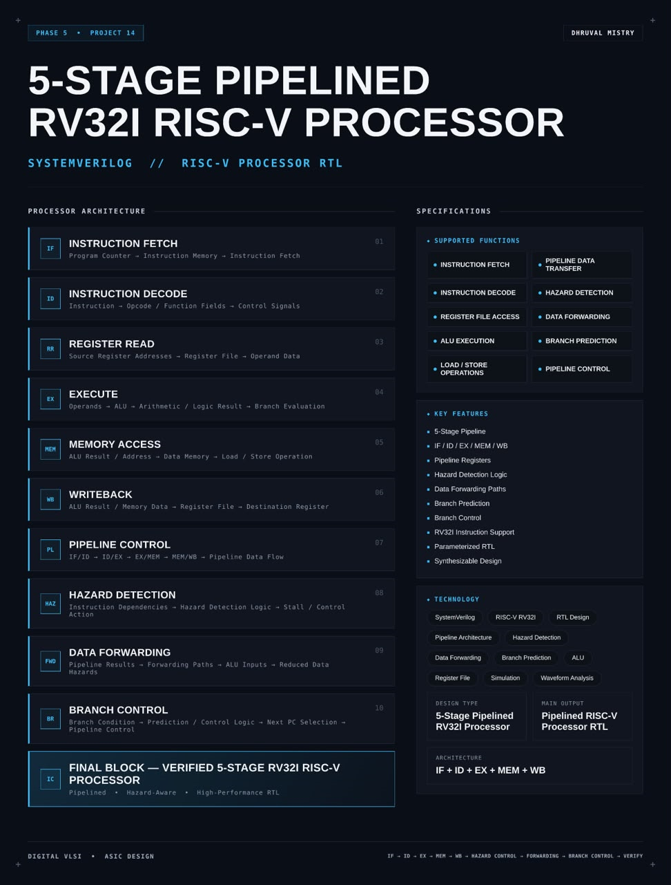
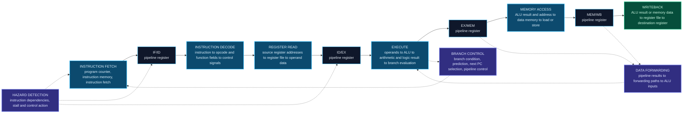
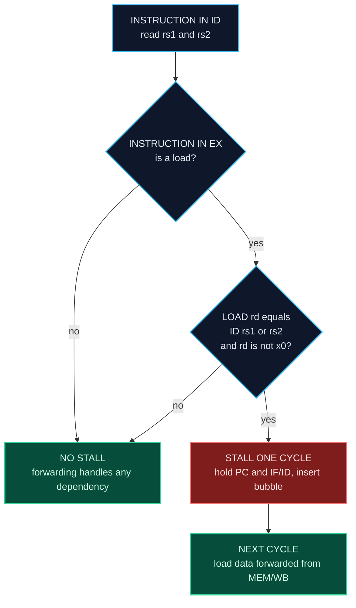
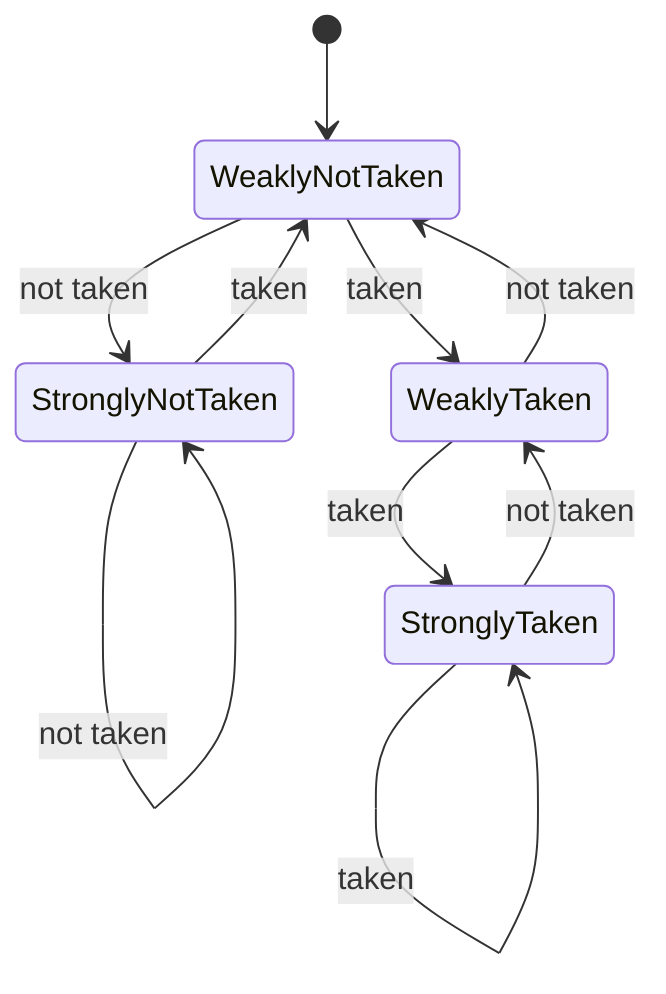
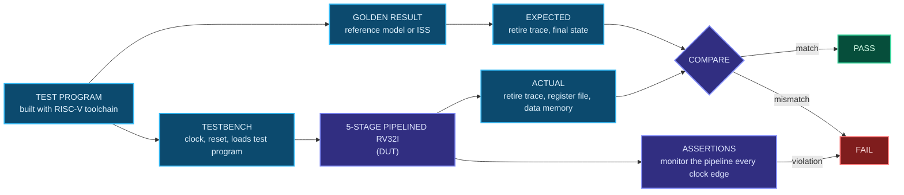

<div align="center">




<b>A synthesizable five-stage pipelined RV32I RISC-V processor with pipeline registers, hazard detection, data forwarding and branch control, written in SystemVerilog.</b>

<br/>


<br/>

[Overview](#overview) |
[At a Glance](#project-at-a-glance) |
[Background](#background-pipelining-and-hazards) |
[Functions](#supported-functions) |
[Architecture](#architecture) |
[Functional Description](#functional-description) |
[Hazards and Control](#pipeline-hazards-and-control) |
[Performance](#performance-analysis) |
[Interface](#interface) |
[Getting Started](#getting-started) |
[Verification](#verification) |
[Synthesis](#synthesis) |
[Applications](#applications) |
[FAQ](#faq) |
[License](#license)

</div>

---

## Overview

This project implements a **5-stage pipelined RV32I RISC-V processor** in **SystemVerilog**.

A processor does not have to finish one instruction before it starts the next. In a **pipeline**, the work of executing an instruction is cut into five stages, and each stage works on a different instruction at the same time. The five stages are **Instruction Fetch (IF)**, **Instruction Decode (ID)**, **Execute (EX)**, **Memory Access (MEM)** and **Writeback (WB)**. **Pipeline registers** (IF/ID, ID/EX, EX/MEM and MEM/WB) sit between the stages and carry each instruction's data and control signals forward on every clock edge. When the pipeline is full, one instruction finishes in every clock cycle, even though each instruction takes five cycles from start to end.

Overlapping instructions creates **hazards**: situations where the next instruction cannot safely proceed. This design handles them in hardware. A **hazard detection unit** finds dependencies between instructions and stalls the pipeline when needed. A **forwarding unit** sends results straight from later pipeline stages back to the ALU inputs, so most data hazards cost nothing. **Branch control** evaluates branch conditions, selects the next program counter and flushes the instructions fetched from the wrong path.

The processor implements the **RV32I base integer instruction set**. It uses separate instruction and data memories, so fetching an instruction and accessing data never compete for one memory. The design is **parameterized**, **sequential** and written in a **synthesis-friendly** style. It is checked with test programs built with the RISC-V GNU toolchain, a testbench that compares retired instructions with a golden result, **assertions** and waveform analysis, and packaged as a reusable processor core.

<table>
<tr>
<td width="50%" valign="top">

#### Objectives
- Design a 5-stage pipelined RV32I processor in SystemVerilog
- Separate the datapath into IF, ID, EX, MEM and WB stages
- Carry data and control through pipeline registers
- Detect data hazards and stall the pipeline when needed
- Forward results to the ALU inputs to remove most stalls
- Control branches, select the next PC and flush wrong-path instructions
- Keep the register file, ALU and memory interfaces simple and correct
- Verify the processor against a golden result with hazard-focused tests

</td>
<td width="50%" valign="top">

#### Key Features
- 5-stage pipeline
- IF / ID / EX / MEM / WB structure
- Pipeline registers
- Hazard detection logic
- Data forwarding paths
- Branch prediction
- Branch control
- RV32I instruction support
- Parameterized RTL
- Synthesizable design

</td>
</tr>
</table>

---

## Project at a Glance

| Attribute | Detail |
|:--|:--|
| **Design type** | 5-stage pipelined RISC-V processor |
| **Description language** | SystemVerilog (RTL) |
| **Instruction set** | RISC-V RV32I base integer ISA |
| **Pipeline stages** | IF, ID, EX, MEM, WB |
| **Pipeline registers** | IF/ID, ID/EX, EX/MEM, MEM/WB |
| **Data hazards** | Forwarding paths plus a load-use stall |
| **Control hazards** | Branch prediction and control, with flush of wrong-path instructions |
| **Memory structure** | Separate instruction memory and data memory |
| **Register file** | 32 registers of 32 bits, `x0` hardwired to zero |
| **Main output** | Pipelined RV32I processor RTL |
| **Ideal throughput** | One instruction per clock cycle |
| **Checking** | Test programs, golden comparison, assertions, waveform analysis |
| **Functions** | 10 (fetch, decode, register access, ALU, load and store, data transfer, hazards, forwarding, prediction, control) |
| **Simulation** | Verilator |
| **Waveform analysis** | GTKWave |
| **Synthesis** | Yosys |
| **License** | MIT |

---

## Background: Pipelining and Hazards

#### Why pipeline

A simple processor executes one instruction per clock cycle, with the whole instruction going through fetch, decode, execute, memory and writeback inside that one cycle. The clock period then has to cover the sum of all stage delays, so the clock is slow. A pipelined processor cuts the same work into stages. The clock period only has to cover the slowest stage plus the small delay of a pipeline register, so the clock can be much faster. Because a new instruction enters the pipeline in every cycle, one instruction still completes per cycle once the pipeline is full.

#### The five stages

| Stage | Name | Work done |
|:-:|:--|:--|
| IF | Instruction Fetch | Use the program counter (PC) to read the instruction from instruction memory, and compute the next PC |
| ID | Instruction Decode | Split the instruction into opcode and function fields, generate control signals, read the source registers and build the immediate |
| EX | Execute | Run the ALU for arithmetic and logic, compute addresses, evaluate branch conditions |
| MEM | Memory Access | Read data memory for a load, or write it for a store |
| WB | Writeback | Write the ALU result or the loaded data back to the destination register |

#### Hazards

Overlapping instructions causes three kinds of problems:

| Hazard | Cause | Example |
|:--|:--|:--|
| **Data hazard** | An instruction needs a result that an earlier instruction has not yet written back | `add x1, x2, x3` followed by `sub x4, x1, x5` |
| **Control hazard** | The pipeline fetches instructions before it knows whether a branch is taken | The two instructions after a taken branch are on the wrong path |
| **Structural hazard** | Two instructions need the same hardware in the same cycle | Fetch and a load both need one memory |

This design removes structural hazards by using separate instruction and data memories, reduces data hazards with **forwarding**, handles the one remaining data case (a load followed by an instruction that uses the loaded value) with a **one-cycle stall**, and handles control hazards with **branch prediction and flushing**.

---

## Supported Functions

| Group | Function | Description |
|:--|:--|:--|
| **Fetch** | `INSTRUCTION FETCH` | Reads the instruction at the program counter and updates the PC |
| **Decode** | `INSTRUCTION DECODE` | Decodes opcode and function fields and generates control signals |
| **Registers** | `REGISTER FILE ACCESS` | Reads two source registers and writes one destination register |
| **Execute** | `ALU EXECUTION` | Performs arithmetic, logic, shift and comparison operations |
| **Memory** | `LOAD / STORE OPERATIONS` | Reads and writes data memory |
| **Pipeline** | `PIPELINE DATA TRANSFER` | Moves data and control between stages through pipeline registers |
| **Pipeline** | `PIPELINE CONTROL` | Stalls, flushes and enables the pipeline registers |
| **Hazards** | `HAZARD DETECTION` | Finds instruction dependencies that need a stall or other action |
| **Hazards** | `DATA FORWARDING` | Sends pipeline results to the ALU inputs to reduce data hazards |
| **Branch** | `BRANCH PREDICTION` | Predicts the next PC for branches and corrects it on a misprediction |

---

## Architecture

The processor is organized as five stages with four sets of pipeline registers between them. Three control blocks work across the stages: the **hazard detection unit**, the **forwarding unit** and the **branch control** logic.

#### Pipeline diagram

```text
      IF               ID                EX                MEM               WB
 +-----------+    +-----------+     +-----------+     +-----------+     +-----------+
 |   PC      |    | decode    |     |   ALU     |     |  data     |     | select    |
 |   next PC |    | control   |     |   branch  |     |  memory   |     | result    |
 |   instr   | -> | reg read  | ->  |   compare | ->  |  load     | ->  | write     |
 |   memory  |    | immediate |     |   address |     |  store    |     | register  |
 +-----------+    +-----------+     +-----------+     +-----------+     +-----------+
       |  IF/ID          |  ID/EX          |  EX/MEM         |  MEM/WB        |
       +--> register ----+--> register ----+--> register ----+--> register ---+
                          ^                 |                  |
                          |   FORWARDING    |                  |
                          +--- UNIT <-------+------------------+
                          |
      HAZARD DETECTION UNIT: stall PC and IF/ID, insert bubble into ID/EX
      BRANCH CONTROL: next PC selection, prediction check, flush IF/ID and ID/EX
```

#### Detailed datapath

```text
          +-----+   +--------+  +-------+  +------------------------------+
  PC ---->| IMEM|-->| IF/ID  |->|DECODE |->| REGISTER FILE (2 read, 1 write)|
   ^      +-----+   +--------+  | CTRL  |  +---------------+--------------+
   |                            | IMM   |                  |
   |                            +---+---+                  v
   |                                |             +--------+--------+
   |                                +------------>|     ID/EX       |
   |                                              +--------+--------+
   |         forwarded values (from EX/MEM, MEM/WB)        |
   |             +------> MUX A --+                        v
   |             +------> MUX B --+----> ALU ----> EX/MEM  +--> DMEM --> MEM/WB --> WB MUX
   |                                      |                                           |
   |            branch condition ---------+                                           |
   +---------------- next PC select <--- BRANCH CONTROL        write data <------------+
                                                             (to register file)
```

#### Data flow



#### Block breakdown

| # | Block | Role |
|:-:|:--|:--|
| `01` | **Instruction Fetch** | Program counter to instruction memory to instruction fetch |
| `02` | **Instruction Decode** | Instruction to opcode and function fields to control signals |
| `03` | **Register Read** | Source register addresses to register file to operand data |
| `04` | **Execute** | Operands to ALU to arithmetic or logic result to branch evaluation |
| `05` | **Memory Access** | ALU result and address to data memory for a load or store operation |
| `06` | **Writeback** | ALU result or memory data to register file to destination register |
| `07` | **Pipeline Control** | IF/ID to ID/EX to EX/MEM to MEM/WB, pipeline data flow |
| `08` | **Hazard Detection** | Instruction dependencies to hazard detection logic to stall or control action |
| `09` | **Data Forwarding** | Pipeline results to forwarding paths to ALU inputs to reduced data hazards |
| `10` | **Branch Control** | Branch condition to prediction and control logic to next PC selection to pipeline control |

> **Final design block:** `IF + ID + EX + MEM + WB`

---

## Functional Description

#### Instruction fetch (IF)
The program counter holds the address of the next instruction. Each cycle the instruction memory is read at that address, and the PC is updated to the next sequential address (`PC + 4`), to a predicted branch target, or to a corrected target after a branch decision. The fetched instruction and its PC are stored in the IF/ID register.

#### Instruction decode (ID)
The instruction is split into its fields: opcode, `rd`, `funct3`, `rs1`, `rs2` and `funct7`. The control unit turns the opcode and function fields into control signals for the later stages. The immediate generator builds the 32-bit immediate for the instruction format (I, S, B, U or J). The hazard detection unit also looks at this stage, because that is where an instruction's source registers are known.

#### Register read
The register file has two read ports and one write port. The source register numbers `rs1` and `rs2` select the operand data, which is stored in the ID/EX register together with the immediate and the control signals. Register `x0` always reads as zero and ignores writes.

#### Execute (EX)
The ALU performs the operation chosen by the control signals: add, subtract, shift, compare, and, or, xor. Its inputs come from the register data, the immediate, the PC (for `AUIPC` and branch targets) or from the **forwarding unit**. For loads and stores the ALU computes the memory address. For branches the EX stage compares the operands and evaluates the branch condition.

#### Memory access (MEM)
For a load, the data memory is read at the address computed by the ALU. For a store, the data memory is written with the store data. Other instructions pass through this stage without touching memory. Because the data memory is separate from the instruction memory, this stage never conflicts with the fetch of the next instruction.

#### Writeback (WB)
A multiplexer picks the value to write back: the ALU result or the data loaded from memory. The value is written to the destination register `rd`, unless the instruction does not write a register or `rd` is `x0`.

#### Pipeline registers
Four registers hold the state between stages. Each carries the data and the control signals that the later stages still need.

| Register | Holds |
|:--|:--|
| **IF/ID** | PC, instruction, and the predicted next PC or prediction bit |
| **ID/EX** | PC, `rs1` data, `rs2` data, immediate, `rs1`, `rs2`, `rd`, ALU control fields, and control signals (ALU source, branch, jump, memory read, memory write, memory-to-register, register write) |
| **EX/MEM** | ALU result, store data, `rd`, branch outcome, and control signals (memory read, memory write, memory-to-register, register write) |
| **MEM/WB** | Loaded data, ALU result, `rd`, and control signals (memory-to-register, register write) |

Each register can be **held** (stalled) or **cleared** (flushed to a bubble) by the pipeline control logic.

#### Pipeline control
Combines the outputs of the hazard detection unit and the branch control into enable and clear signals for the PC and the pipeline registers. A **stall** keeps the PC and the IF/ID register unchanged and puts a bubble into ID/EX. A **flush** replaces the wrong-path instructions in IF/ID and ID/EX with bubbles. A **bubble** is an instruction that does nothing: all its register-write, memory-write and branch controls are zero.

#### Hazard detection
Finds the situations that forwarding cannot solve and requests a stall. See [Pipeline Hazards and Control](#pipeline-hazards-and-control).

#### Data forwarding
Compares the source registers of the instruction in EX with the destination registers of the instructions in MEM and WB, and selects the forwarded value instead of the stale register data. See [Pipeline Hazards and Control](#pipeline-hazards-and-control).

#### Branch control
Evaluates the branch condition in EX, compares the result with the prediction, selects the next PC and, if the prediction was wrong, flushes the wrong-path instructions. See [Pipeline Hazards and Control](#pipeline-hazards-and-control).

#### Control signals

| Signal | Meaning |
|:--|:--|
| ALU source | Selects register data or the immediate as the second ALU operand |
| ALU operation | Selects the ALU function from `funct3`, `funct7` and the opcode |
| Branch | Instruction is a conditional branch |
| Jump | Instruction is `JAL` or `JALR` |
| Memory read | Instruction is a load |
| Memory write | Instruction is a store |
| Memory to register | Writeback takes the loaded data instead of the ALU result |
| Register write | Instruction writes a destination register |

#### Instruction groups (RV32I)

| Group | Instructions |
|:--|:--|
| Register-register arithmetic and logic | `ADD`, `SUB`, `SLL`, `SLT`, `SLTU`, `XOR`, `SRL`, `SRA`, `OR`, `AND` |
| Register-immediate arithmetic and logic | `ADDI`, `SLTI`, `SLTIU`, `XORI`, `ORI`, `ANDI`, `SLLI`, `SRLI`, `SRAI` |
| Loads | `LB`, `LH`, `LW`, `LBU`, `LHU` |
| Stores | `SB`, `SH`, `SW` |
| Conditional branches | `BEQ`, `BNE`, `BLT`, `BGE`, `BLTU`, `BGEU` |
| Jumps | `JAL`, `JALR` |
| Upper immediate | `LUI`, `AUIPC` |
| System and memory ordering | `FENCE`, `ECALL`, `EBREAK` (handling is listed in the configuration table) |

---

## Pipeline Hazards and Control

#### Normal pipeline flow

When there are no hazards, a new instruction enters the pipeline every cycle and one instruction completes every cycle.

```text
 cycle        1    2    3    4    5    6    7    8
 instr 1      IF   ID   EX   MEM  WB
 instr 2           IF   ID   EX   MEM  WB
 instr 3                IF   ID   EX   MEM  WB
 instr 4                     IF   ID   EX   MEM  WB
 instr 5                          IF   ID   EX   MEM  WB
```

From cycle 5 on, all five stages are busy, and one instruction finishes in each cycle.

#### Data hazard solved by forwarding

```text
 cycle                 1    2    3    4    5    6    7    8
 add x1, x2, x3        IF   ID   EX   MEM  WB
 sub x4, x1, x5             IF   ID   EX   MEM  WB
 and x6, x1, x7                  IF   ID   EX   MEM  WB
 or  x8, x1, x9                       IF   ID   EX   MEM  WB

 sub  needs x1 in EX (cycle 4):  forwarded from EX/MEM  (add result, one stage ahead)
 and  needs x1 in EX (cycle 5):  forwarded from MEM/WB  (add result, two stages ahead)
 or   reads x1 in ID (cycle 5):  add is writing x1 in WB in the same cycle
                                 (same-cycle write and read behavior is a design choice)
```

Without forwarding, `sub` and `and` would have to wait until `add` had written `x1` back, which costs two stall cycles each. With forwarding, they proceed without delay.

#### Forwarding unit conditions

The forwarding unit controls two multiplexers in front of the ALU, one for each operand. For the first operand (`rs1` of the instruction in EX):

| ALU input select | Condition | Source |
|:-:|:--|:--|
| `10` | EX/MEM register write is set, EX/MEM `rd` is not `x0`, and EX/MEM `rd` equals ID/EX `rs1` | Result in the EX/MEM register |
| `01` | MEM/WB register write is set, MEM/WB `rd` is not `x0`, MEM/WB `rd` equals ID/EX `rs1`, and the EX/MEM condition above is not true | Value in the MEM/WB register |
| `00` | None of the above | Register file data from the ID/EX register |

The second operand (`rs2`) uses the same rules with ID/EX `rs2`.

```text
 forward A = 10   if  EX/MEM.RegWrite and EX/MEM.rd != 0 and EX/MEM.rd == ID/EX.rs1
 forward A = 01   if  MEM/WB.RegWrite and MEM/WB.rd != 0 and MEM/WB.rd == ID/EX.rs1
                      and not (the EX/MEM condition above)
 forward A = 00   otherwise

 forward B: same rules with ID/EX.rs2
```

Rules that follow from this:
- The **EX/MEM source has priority**, because it holds the newest value when two earlier instructions write the same register.
- **`x0` is never forwarded**, because it is always zero.
- A value is only forwarded when the earlier instruction **writes a register**.
- The forwarded value must also reach the **store data path**. A store that stores a just-computed register needs the forwarded `rs2` value for its data.
- The value in the EX/MEM register of a **load** is the address, not the loaded data. A load result cannot be forwarded from EX/MEM, which is why a load-use case needs a stall.

#### Load-use hazard and the stall

A load only produces its data at the end of the MEM stage. The instruction right behind it needs that data at the start of its EX stage, which is one cycle too early even with forwarding. The pipeline must insert one bubble.

```text
 cycle                 1    2    3    4    5    6    7
 lw  x1, 0(x2)         IF   ID   EX   MEM  WB
 add x4, x1, x5             IF   ID   ID   EX   MEM  WB
 next instruction                IF   IF   ID   EX   MEM
 bubble                                 --- (in EX during cycle 4)

 cycle 3:  hazard detected, lw is in EX, add is in ID
 cycle 4:  add repeats ID, a bubble moves into EX, PC and IF/ID are held
 cycle 5:  add in EX gets the load data forwarded from MEM/WB
```

The hazard detection unit finds this case in the ID stage:

```text
 stall  =  ID/EX.MemRead
           and ID/EX.rd != 0
           and ( ID/EX.rd == IF/ID.rs1   or   ID/EX.rd == IF/ID.rs2 )
```

| Action on stall | Effect |
|:--|:--|
| Hold the PC | The next instruction is fetched again |
| Hold IF/ID | The dependent instruction stays in decode |
| Clear the ID/EX control signals | A bubble (no operation) enters the EX stage |



A compiler or a programmer can avoid the stall by placing an unrelated instruction between the load and its use. The hardware still handles the case correctly when that is not possible.

#### Control hazards and branch control

The processor does not know whether a branch is taken until the branch has been decided. By then, the next instructions have already been fetched. Branch control deals with this in three steps: **predict**, **evaluate** and **correct**.

1. **Predict.** In the fetch stage, the processor guesses the next PC. With a simple scheme the guess is "not taken", so fetching goes on with `PC + 4`.
2. **Evaluate.** The branch condition is computed in a later stage by comparing the register operands. The stage in which the branch is resolved is listed in the configuration table.
3. **Correct.** If the guess was wrong, the correct target is loaded into the PC, and the wrong-path instructions that were fetched in the meantime are **flushed** (turned into bubbles).

```text
 Taken branch, resolved in EX, predicted not taken:

 cycle           1    2    3    4    5    6    7
 beq (taken)     IF   ID   EX   MEM  WB
 wrong path 1         IF   ID   --              flushed
 wrong path 2              IF   --              flushed
 branch target                  IF   ID   EX   MEM
                              ^ next PC redirected to the branch target at the end of cycle 3
```

In this example the misprediction costs **two cycles**, which are the two flushed instructions. If the branch is resolved earlier, in the ID stage, the penalty is one cycle. If the branch is predicted correctly, the penalty is zero.

| Branch outcome | Prediction | Result | Penalty |
|:--|:--|:--|:-:|
| Not taken | Not taken | Pipeline continues | 0 cycles |
| Taken | Taken, correct target | Pipeline continues | 0 cycles |
| Taken | Not taken | Flush wrong-path instructions, redirect PC | Depends on the resolve stage |
| Not taken | Taken | Flush wrong-path instructions, restore `PC + 4` | Depends on the resolve stage |

#### Prediction schemes

The prediction scheme used by this processor is listed in the configuration table. Common schemes:

| Scheme | How it predicts | Cost |
|:--|:--|:--|
| Static not taken | Always predicts that a branch is not taken | No extra hardware |
| Static backward taken | Predicts taken for backward branches (loops) and not taken for forward ones | Needs the sign of the offset |
| 1-bit dynamic | Remembers whether the branch was last taken | A small table of bits |
| 2-bit dynamic | Saturating counter that needs two wrong guesses to change its prediction | A small table of counters |



The diagram shows how a 2-bit saturating counter moves. States `StronglyNotTaken` and `WeaklyNotTaken` predict not taken, and states `WeaklyTaken` and `StronglyTaken` predict taken.

#### Jumps

`JAL` has a target that is known from the instruction itself, so it can be redirected early. `JALR` needs the value of a register, so its target is only known in EX, after forwarding. Both write the return address (`PC + 4`) to `rd`. The stage in which each jump is resolved is listed in the configuration table.

#### Structural hazards

The instruction memory is read in IF and the data memory is accessed in MEM. They are **separate memories**, so a load or store in MEM never blocks the fetch of another instruction. The register file has two read ports and one write port, so ID can read two operands while WB writes one result.

#### Register file same-cycle behavior

An instruction in ID can read a register that an older instruction is writing in WB in the same cycle. Two designs solve this:

| Choice | Behavior |
|:--|:--|
| Write in the first half of the cycle, read in the second half | The reader gets the new value directly |
| Add a bypass inside the register file | The new write data is passed to the read port when the register numbers match |

The choice used by this processor is listed in the configuration table.

---

## Performance Analysis

#### Ideal and real throughput

In a full pipeline with no hazards, **CPI** (clock cycles per instruction) is 1. Stalls and flushes add cycles:

```text
 CPI  =  1  +  ( load-use stalls per instruction )
            +  ( branch frequency  x  misprediction rate  x  penalty in cycles )
```

#### Illustrative example

| Quantity | Example value |
|:--|:-:|
| Loads, as a share of all instructions | 25 percent |
| Loads followed by an instruction that uses the loaded value | 30 percent of loads |
| Load-use stall cycles per instruction | 0.25 x 0.30 x 1 = 0.075 |
| Branches, as a share of all instructions | 15 percent |
| Mispredicted branches | 40 percent of branches |
| Penalty of a misprediction | 2 cycles |
| Branch penalty cycles per instruction | 0.15 x 0.40 x 2 = 0.12 |
| **CPI** | 1 + 0.075 + 0.12 = **1.195** |

These numbers show how the formula works. They are not measured results of this processor.

#### Pipelined compared with single-cycle (illustrative)

In a single-cycle processor, the clock period must cover all stages together. In the pipelined processor, it only has to cover the slowest stage plus the pipeline register delay.

| Quantity | Single-cycle | Pipelined |
|:--|:-:|:-:|
| Stage delays (example) | IF 2.0, ID 1.5, EX 2.0, MEM 2.0, WB 1.0 ns | same stages |
| Clock period | 8.5 ns (sum of stages) | 2.2 ns (slowest stage 2.0 plus 0.2 register overhead) |
| CPI | 1 | 1.195 |
| Time per instruction | 8.5 ns | 2.2 x 1.195 = about 2.63 ns |
| Speedup | 1 | about 3.2 times |

The speedup is below the ideal 5 times because the stages are not perfectly balanced, pipeline registers add delay, and hazards add stall and flush cycles. The measured values for this processor are listed in the verification and synthesis results tables.

#### Cost of the pipeline

| Item | Added hardware |
|:--|:--|
| Pipeline registers | Four sets of registers between the stages |
| Forwarding unit | Comparators and two multiplexers at the ALU inputs |
| Hazard detection unit | A comparator and stall and bubble logic |
| Branch control | Condition evaluation, prediction state and flush logic |

---

## Interface

#### Ports

| Port | Direction | Description |
|:--|:-:|:--|
| Clock | Input | Clock for the whole pipeline |
| Reset | Input | Resets the PC and clears the pipeline |
| Instruction address | Output | Address of the instruction to fetch |
| Instruction data | Input | Instruction returned by the instruction memory |
| Data address | Output | Address of a load or store |
| Data write data | Output | Data for a store |
| Data write enable | Output | Marks a store |
| Data read enable | Output | Marks a load |
| Data read data | Input | Data returned by the data memory |
| Byte or size control | Output | Selects byte, halfword or word access |

The processor core is connected to an instruction memory and a data memory in the testbench or in a larger system. Exact port names, widths and reset polarity are defined in the RTL sources under `rtl/`.

#### Parameters and configuration

| Item | Value |
|:--|:-:|
| Reset PC value | `TBD` |
| Instruction memory size | `TBD` |
| Data memory size | `TBD` |
| Branch resolve stage | `TBD` |
| Jump resolve stage (`JAL` and `JALR`) | `TBD` |
| Branch prediction scheme | `TBD` |
| Branch predictor table size | `TBD` |
| Register file same-cycle read and write behavior | `TBD` |
| Instruction and data memory read timing | `TBD` |
| Handling of misaligned accesses | `TBD` |
| Handling of `FENCE`, `ECALL`, `EBREAK` and illegal instructions | `TBD` |

---

## Operating Sequence

Every instruction goes through the same path: fetch, decode, register read, execute, memory access and writeback, with the hazard, forwarding and branch logic working alongside.


1. **Reset.** The PC is set to the reset address and the pipeline registers hold bubbles.
2. **Fill.** The first instruction needs five cycles to reach writeback. After that, one instruction completes per cycle.
3. **Run.** In every cycle each stage works on a different instruction. The hazard unit, the forwarding unit and the branch control watch the dependencies.
4. **Stall.** When a load is followed by an instruction that uses its result, the pipeline stalls for one cycle.
5. **Redirect.** When a branch or jump changes the flow, the PC is redirected and the wrong-path instructions are flushed.
6. **Retire.** Each instruction that reaches writeback is complete, and the register file holds its result.

---

## Repository Structure

```text
5-stage-pipelined-rv32i-risc-v-processor/
├── rtl/
│   ├── riscv_pipeline_top.sv   # Top-level pipelined processor
│   ├── if_stage.sv             # Instruction fetch stage and PC logic
│   ├── id_stage.sv             # Instruction decode stage
│   ├── ex_stage.sv             # Execute stage
│   ├── mem_stage.sv            # Memory access stage
│   ├── wb_stage.sv             # Writeback stage
│   ├── pipe_regs.sv            # IF/ID, ID/EX, EX/MEM and MEM/WB registers
│   ├── regfile.sv              # Register file
│   ├── alu.sv                  # ALU
│   ├── control_unit.sv         # Main control decoder
│   ├── imm_gen.sv              # Immediate generator
│   ├── hazard_unit.sv          # Hazard detection and stall control
│   ├── forwarding_unit.sv      # Data forwarding control
│   ├── branch_ctrl.sv          # Branch evaluation, prediction and flush control
│   └── filelist.f              # List of RTL files for the tools
├── tb/
│   ├── imem_model.sv           # Instruction memory model (loads a hex file)
│   ├── dmem_model.sv           # Data memory model
│   ├── pipeline_checker.sv     # Assertions on pipeline behavior
│   └── pipeline_tb.sv          # Self-checking testbench with retire trace comparison
├── sw/
│   ├── tests/                  # Directed assembly tests (hazards, branches, memory)
│   ├── link.ld                 # Linker script
│   └── golden/                 # Golden results for the test programs
├── sim/
│   └── waves.vcd               # Generated waveform dump
├── synth/
│   ├── synth.ys                # Yosys synthesis script
│   ├── pipeline_netlist.v      # Gate-level netlist
│   └── synth_report.txt        # Yosys stat report
├── LICENSE
└── README.md
```

---

## Technology Stack

| Tool | Role in this project |
|:--|:--|
|  | RTL design, testbench and assertions |
|  | Builds the test programs into hex files |
|  | Compiles and simulates the processor |
|  | Views the pipeline waveforms |
|  | Synthesizes the RTL to a gate-level netlist |

---

## Getting Started

#### Prerequisites

| Tool | Purpose | Version |
|:--|:--|:--|
| Verilator | RTL simulation | 5.x or later |
| GTKWave | Waveform viewer | Any recent |
| Yosys | RTL synthesis | Any recent |
| RISC-V GNU toolchain | Builds test programs | A bare-metal toolchain such as `riscv64-unknown-elf-gcc` |

```bash
# Ubuntu / Debian
sudo apt update
sudo apt install verilator gtkwave yosys gcc-riscv64-unknown-elf
```

#### 1. Clone

```bash
git clone https://github.com/dhruvalmistry2007/5-stage-pipelined-rv32i-risc-v-processor.git
cd 5-stage-pipelined-rv32i-risc-v-processor
```

#### 2. Build a test program

The processor runs machine code that is loaded into the instruction memory model from a hex file. A test program is assembled for RV32I, converted to a flat binary and then to one 32-bit word per line.

```bash
riscv64-unknown-elf-gcc -march=rv32i -mabi=ilp32 -nostdlib -nostartfiles \
  -T sw/link.ld -o sw/tests/hazard_test.elf sw/tests/hazard_test.S
riscv64-unknown-elf-objcopy -O binary sw/tests/hazard_test.elf sw/tests/hazard_test.bin
od -An -v -tx4 -w4 sw/tests/hazard_test.bin > sw/tests/hazard_test.hex
```

The testbench loads the hex file with `$readmemh`.

#### 3. Simulate

The testbench uses clock delays, so the simulation is built with timing support.

```bash
verilator --binary --timing --trace --assert -Wall --top-module pipeline_tb \
  -f rtl/filelist.f tb/imem_model.sv tb/dmem_model.sv tb/pipeline_checker.sv tb/pipeline_tb.sv
./obj_dir/Vpipeline_tb +PROGRAM=sw/tests/hazard_test.hex
```

#### 4. View waveforms

```bash
gtkwave sim/waves.vcd
```

Add the PC of each stage, the pipeline registers, the stall, flush and forwarding select signals to follow an instruction through the pipeline.

#### 5. Synthesize

```bash
yosys -s synth/synth.ys
```

The script reads the files listed in `rtl/filelist.f`, runs `synth -top riscv_pipeline_top`, prints `stat` and writes the netlist.

---

## Verification

The testbench loads a test program into the instruction memory model, runs the processor, and records every instruction that **retires** in the writeback stage: its PC, destination register and written value. This **retire trace** is compared with a golden result for the same program. The golden result comes from a reference model, such as a single-cycle version of the processor or an RISC-V instruction set simulator. Assertions watch the pipeline on every clock edge, and the results are inspected as waveforms.



#### Test plan

| Area | Scenario | Expected behavior |
|:--|:--|:--|
| Reset | Apply reset | PC is at the reset address and the pipeline holds bubbles |
| Pipeline fill | Run a short sequence of independent instructions | One instruction retires per cycle after the pipeline fills |
| Arithmetic and logic | All R-type and I-type ALU instructions | Results match the golden trace |
| Shifts and comparisons | `SLL`, `SRL`, `SRA`, `SLT`, `SLTU` and the immediate forms | Results match the golden trace |
| Upper immediates | `LUI` and `AUIPC` | Results match the golden trace |
| Register `x0` | Write to `x0`, then read it | `x0` always reads as zero |
| Forwarding from EX/MEM | Dependent instruction immediately after a producer | Correct result with no stall |
| Forwarding from MEM/WB | Dependent instruction two positions after a producer | Correct result with no stall |
| Forwarding priority | Two earlier instructions write the same register | The newer value is used |
| Forwarding to stores | Store a register computed just before | The correct data is stored |
| Same-cycle write and read | Read a register that is being written in WB | The behavior matches the chosen design |
| Load-use hazard | Load followed directly by an instruction using the result | One stall cycle and a correct result |
| Load with a gap | Load followed by an unrelated instruction, then the user | No stall and a correct result |
| Loads and stores | Byte, halfword and word accesses, signed and unsigned loads | Memory and register results match the golden trace |
| Branch not taken | All branch types with a false condition | Pipeline continues with no flush when predicted not taken |
| Branch taken | All branch types with a true condition | Wrong-path instructions are flushed and the target is fetched |
| Misprediction recovery | Alternating taken and not-taken branches | Correct execution regardless of the prediction |
| Jumps | `JAL` and `JALR`, including a jump after a producer of the target register | Correct return address and target |
| Branch after load | Branch that depends on a loaded value | Stall, then a correct branch decision |
| Loops | Counting loops and nested loops | Final values match the golden result |
| Back-to-back hazards | Several dependent instructions in a row | Correct results with the minimum number of stalls |
| Random programs | Random instruction sequences | Retire trace matches the golden result |

#### Assertions

| Property | What it checks |
|:--|:--|
| `x0` never written | The register file never stores a non-zero value in `x0` |
| No write from bubbles | A flushed or stalled instruction never writes a register or memory |
| Forwarding select legality | A forward select other than `00` is used only when the source stage writes a register, its `rd` is not `x0`, and it matches the source register |
| Forwarding priority | EX/MEM forwarding is chosen over MEM/WB forwarding when both match |
| Load-use stall | When the load-use condition is true, the PC and IF/ID hold their value and a bubble enters ID/EX |
| Flush correctness | After a mispredicted branch, exactly the wrong-path instructions are turned into bubbles |
| PC alignment | The PC is always a multiple of four |
| One retire per cycle at most | No more than one instruction retires in a clock cycle |
| No unknown values | Pipeline registers do not contain unknown bits after reset |
| Reset state | After reset the PC and the pipeline match their reset values |

#### Coverage matrix

| Area | Functions checked | Result |
|:--|:--|:-:|
| Fetch and decode | Instruction fetch, instruction decode, all instruction formats | `TBD` |
| Execute | ALU execution, all ALU operations | `TBD` |
| Memory | Load and store operations, all sizes | `TBD` |
| Registers | Register file access, writeback | `TBD` |
| Hazards | Forwarding paths, load-use stall | `TBD` |
| Branches | Branch prediction, branch control, flush | `TBD` |
| Pipeline | Pipeline data transfer, pipeline control | `TBD` |

#### Results

| Metric | Value |
|:--|:-:|
| Test programs passed | `TBD` |
| Instructions retired in the golden comparison | `TBD` |
| Assertion failures | `TBD` |
| Measured CPI on the test programs | `TBD` |
| Load-use stalls counted | `TBD` |
| Branch mispredictions counted | `TBD` |

#### Waveform analysis checklist

| Signal | What to confirm |
|:--|:--|
| PC in each stage | An instruction moves one stage per cycle |
| Pipeline registers | Data and control move forward on every clock edge |
| Forwarding selects | Change only when a dependency exists |
| Stall signal | Raised only for a load-use case, and holds the PC and IF/ID |
| Bubble in ID/EX | Control signals are zero during a stall |
| Branch outcome and flush | Wrong-path instructions turn into bubbles when a branch is mispredicted |
| Register file writes | One write per retiring instruction, never to `x0` |
| Data memory signals | Reads and writes only for loads and stores, with the right size |

---

## Synthesis

The RTL is synthesized with **Yosys** to confirm that the design is synthesizable. The flow reads the SystemVerilog sources, elaborates the design hierarchy, maps it to generic logic cells, prints a cell statistics report and writes the gate-level netlist. The netlist and the report are stored in [`synth/`](synth/).


| Step | Command | Purpose |
|:--|:--|:--|
| Read | `read_verilog -sv` | Loads the SystemVerilog RTL |
| Synthesize | `synth -top riscv_pipeline_top` | Elaborates and maps the design to generic gates |
| Report | `stat` | Prints cell and wire statistics |
| Export | `write_verilog` | Writes the gate-level netlist |

#### Results

| Metric | Value |
|:--|:-:|
| Top module | `riscv_pipeline_top` |
| Total cells | `TBD` |
| Flip-flops | `TBD` |
| Pipeline register bits | `TBD` |
| Register file bits | `TBD` |
| Wires / wire bits | `TBD` |
| Logic depth / critical path | `TBD` |
| Area | `TBD` |

The instruction and data memories are models in the testbench. Inside a synthesis run, the core is synthesized with its memory interfaces as ports. A generic Yosys run does not give a real clock frequency. The achievable clock frequency needs static timing analysis on a chosen technology.

---

## Design Considerations

| Aspect | Approach |
|:--|:--|
| **Pipeline structure** | Five stages with four pipeline registers, each stage doing a balanced share of the work |
| **Structural hazards** | Separate instruction and data memories, and a register file with two read ports and one write port |
| **Data hazards** | Forwarding from EX/MEM and MEM/WB to the ALU inputs, plus a one-cycle stall for load-use |
| **Control hazards** | Branch prediction, evaluation in a later stage and flushing of wrong-path instructions |
| **Register `x0`** | Always zero, never written, and never forwarded |
| **Bubbles** | A bubble has all write and branch controls cleared, so it cannot change any state |
| **Configurability** | Memory sizes, reset PC and predictor settings set through parameters |
| **Synthesis** | Synthesizable RTL structure, targeting a Yosys flow |
| **Verification** | Retire trace comparison with a golden result, hazard-focused tests and assertions |

#### Current limitations
- RV32I base instructions only, with no multiply, divide, compressed or floating-point extensions
- No interrupts, exceptions, privilege levels or control and status registers
- Instruction and data memories have fixed access timing, with no cache and no wait states
- Simulation-based verification only, with no formal verification
- Branch prediction accuracy depends on the chosen scheme and on the program

---

## Applications

- Learning and teaching how pipelined processors, hazards and forwarding work
- Small embedded RISC-V core for custom ASIC and FPGA designs
- Starting point for adding extensions, caches and exception handling
- Base for a RISC-V system-on-chip together with memory and peripherals
- Reference for comparing single-cycle and pipelined implementations
- Test vehicle for processor verification and performance experiments

---

## Customization

#### Change the branch prediction scheme

1. Choose the scheme (static, 1-bit or 2-bit dynamic) and set the related parameters.
2. Update the fetch stage so it uses the predicted next PC.
3. Update the branch control so it compares the prediction with the actual outcome.
4. Update the configuration table and the performance section of this README.
5. Re-run the branch tests and compare the measured misprediction count.

#### Move branch resolution to another stage

1. Move the comparison logic to the new stage, with forwarding to its inputs.
2. Change the number of instructions that are flushed on a misprediction.
3. Update the flush assertion and the branch tests.
4. Update the configuration table and the penalty values in the performance section.

#### Add an instruction or extension

1. Add the decoding to the control unit and the immediate generator if needed.
2. Add the operation to the ALU or a new execution unit.
3. Add the new control signals to the pipeline registers.
4. Check the effect on the hazard detection and the forwarding paths.
5. Add directed tests and golden results, then re-run the simulation.

---

## Troubleshooting

| Problem | Likely cause | Fix |
|:--|:--|:--|
| `--binary` option not recognized | Verilator version is older than 5.x | Upgrade Verilator to 5.x or later |
| Delays in the testbench are rejected | Timing support is not enabled | Build with `--timing` |
| `waves.vcd` is not generated | Tracing is not enabled | Build with `--trace` and make sure the testbench calls `$dumpfile` and `$dumpvars` |
| Assertions do not fire | Assertions are not enabled in the simulator | Build with `--assert` |
| `riscv64-unknown-elf-gcc` not found | Toolchain is not installed | Install a bare-metal RISC-V GNU toolchain |
| Program runs wrong instructions | Hex file words are in the wrong order or endianness | Check the `od` conversion and the memory load with `$readmemh` |
| Wrong result right after a producer | Forwarding select is wrong or a path is missing | Check the forwarding unit conditions and the ALU input multiplexers |
| Wrong result after a load | Load-use stall is missing | Check the hazard detection condition and that it uses `MemRead` of the ID/EX stage |
| Stalled instruction runs twice | PC or IF/ID were not held during the stall | Hold both the PC and IF/ID when stalling |
| Wrong-path instruction changes a register | Flush does not clear the write controls | Clear all write and branch controls when flushing |
| Value of `x0` changes | Write to `x0` is not blocked | Block register writes when `rd` is `x0` |
| Wrong value read in ID while WB writes | Same-cycle write and read behavior is not handled | Use the write-first design or a register file bypass |
| Yosys cannot find the top module | `-top` name does not match the module name | Use the exact module name from `rtl/riscv_pipeline_top.sv` |

---

## FAQ

**Why does a pipelined processor not run five times faster than a single-cycle one?**
The stages are never perfectly balanced, pipeline registers add delay, and hazards cost cycles. A speedup of three to four times is typical for a classic five-stage pipeline.

**What is forwarding?**
Forwarding sends a result straight from a later pipeline register to the ALU input that needs it, without waiting for the result to be written to the register file. It removes most data hazards without stalling.

**Why does a load followed by its user still need a stall?**
The loaded data is only available at the end of the MEM stage, but the next instruction needs it at the start of EX, which is one cycle earlier. One bubble is the minimum fix.

**What is a bubble?**
A bubble is an empty slot in the pipeline. It is an instruction with all its write and branch controls cleared, so it passes through the stages without changing anything.

**What is a pipeline flush?**
A flush turns the instructions that were fetched on the wrong path of a branch into bubbles, so they never change the processor state.

**Why are there separate instruction and data memories?**
The fetch stage and the memory stage work in the same cycle. With separate memories they never need the same memory at the same time, so there is no structural hazard.

**Why is `x0` never forwarded?**
Register `x0` is always zero, so forwarding a result written to `x0` would give the wrong value. The forwarding conditions therefore require that `rd` is not `x0`.

**Why Verilator, GTKWave and Yosys?**
They are free, open-source tools that cover simulation, waveform viewing and synthesis, so the whole project can be reproduced without licenses.

---

## Learning Outcomes

- Understanding how pipelining raises processor throughput
- Designing the five stages and the pipeline registers of an RV32I processor
- Detecting data hazards and writing forwarding logic
- Handling the load-use case with a stall and a bubble
- Handling control hazards with prediction, evaluation and flushing
- Calculating CPI and the effect of stalls and flushes
- Building test programs with the RISC-V GNU toolchain
- Verifying a processor with a retire trace, a golden result and assertions
- Debugging pipelines with waveform analysis and running RTL synthesis

---

## Design Flow


<div align="center">

`IF` | `ID` | `EX` | `MEM` | `WB` | `HAZARD CONTROL` | `FORWARDING` | `BRANCH CONTROL` | `VERIFY`

</div>

---

## Future Work

- Add the multiply and divide extension
- Add a dynamic branch predictor with a branch target buffer
- Add control and status registers, exceptions and interrupts
- Add instruction and data caches
- Add support for wait states and a bus interface such as AXI4-Lite
- Add formal properties for the forwarding and hazard logic
- Run the RISC-V architecture compliance tests
- Add a performance counter block for cycles, instructions, stalls and flushes
- Run the design through an RTL-to-GDSII flow (OpenLane)

---

## Contributing

Suggestions and improvements are welcome. Open an issue to discuss a change, or submit a pull request with a clear description of what it does and the simulation results that support it.

---

## References

- [Verilator](https://www.veripool.org/verilator/): open-source SystemVerilog simulator
- [GTKWave](https://gtkwave.sourceforge.net/): waveform viewer
- [Yosys Open SYnthesis Suite](https://yosyshq.net/yosys/): open-source RTL synthesis framework
- [RISC-V International](https://riscv.org/technical/specifications/): RISC-V instruction set specifications (RV32I)
- IEEE Std 1800: SystemVerilog language standard
- Patterson and Hennessy, Computer Organization and Design: RISC-V Edition

---

## License

This project is licensed under the **MIT License**. See the [LICENSE](LICENSE) file for details.

---

## Author

<div align="center">

**Dhruval Mistry**

[](https://github.com/dhruvalmistry2007)

<br/>


</div>
